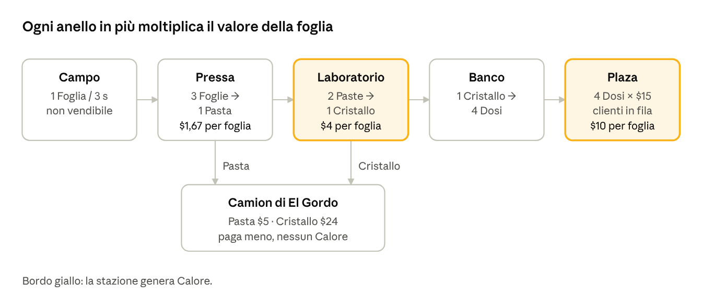

# PATRÓN — Documento di design della Beta

Oct 23, 2026 · @luca · aggiornato il 29 ottobre 2026 con le regole della skill `arcade-idle` (regalo iniziale, Rispetto, scarti e Falò, camion con cassone, mazzette solo al giocatore, spinta degli ordini, forma dell'informazione nel mondo)

PATRÓN è un arcade idle 3D da giocare nel browser del computer in cui un contadino senza niente scala la filiera di un traffico stilizzato, dal campo allo spaccio, fino a diventare il Patrón. Questo documento descrive la **Beta**: le Fasi 0–3 della progressione più il sistema del Calore, abbastanza per capire se il loop diverte. È scritto per essere eseguito da Claude Code passo per passo (sezione 15).

## 1. Visione

**Il gioco in una frase.** Muovi il tuo personaggio con la tastiera o il mouse, trasporti la merce tra le stazioni, incassi, assumi chi lavora al posto tuo e reinvesti, mentre la polizia ti stringe addosso man mano che cresci.

**Pubblico della Beta.** Tu e i tuoi amici, ognuno con il proprio mondo, da computer, nel browser, aprendo un link. Nessun multiplayer.

**Ambientazione.** Una valle immaginaria in un paese sudamericano di fantasia, primi anni '80. Il prodotto è la **Lumina**, una sostanza inventata ricavata da una pianta: cristalli azzurri luminescenti. Nessuna chimica reale, nessuna sostanza reale, nessun nome reale (né "Narcos", né cartelli o persone esistenti), violenza solo suggerita e mai grafica.

**I quattro pilastri.** Ogni scelta di design si giudica contro questi quattro principi.

1.  **Il valore sta a valle.** Come nella realtà, ogni anello della filiera che controlli moltiplica il prezzo. La progressione è una scalata verticale, non solo "più macchine".

2.  **C'è sempre un prossimo passo visibile e vicino.** Il giocatore non deve mai chiedersi cosa fare.

3.  **Crescere costa rischio.** Più produci e vendi in proprio, più sale il Calore. Espansione e prudenza tirano in direzioni opposte.

4.  **Da operaio a Patrón.** L'automazione sposta il giocatore dal trasporto manuale alla gestione. Il ruolo cambia, non solo i numeri.

**Dentro e fuori dalla Beta.**

| Dentro la Beta                             | Fuori dalla Beta (sezione 16)       |
|--------------------------------------------|-------------------------------------|
| Fase 0: onboarding                         | Fase 4: riciclaggio e denaro pulito |
| Fase 1: il Campo e la Pressa               | Fase 5: rotte di esportazione       |
| Fase 2: il Laboratorio                     | Fase 6: impero, Caduta e prestigio  |
| Fase 3: la Plaza e lo spaccio              | Lealtà e informatori                |
| Calore, Quota, perquisizioni, banda rivale | Classifica tra amici online         |
| Ordini speciali di El Gordo                | Pubblicità e acquisti in-app        |
| Salvataggio, guadagni offline              | Versione per telefono e App Store   |

## 2. Stack tecnico e distribuzione

**Decisione: gioco 3D per browser, solo da computer, in TypeScript con Three.js, pubblicato gratis su GitHub Pages.** Si gioca aprendo un link: niente da installare, niente App Store.

**Perché solo computer.** È l'opzione che dà il risultato migliore con gli strumenti che hai.

- Tutto lo sforzo va su grafica, gameplay e bilanciamento, invece che sull'adattarsi a due tipi di schermo e di comandi.

- La tastiera è più precisa di un joystick touch, e lo schermo largo mostra più catena di produzione insieme: la gestione si legge meglio.

- Un computer ha molta più potenza grafica di un telefono: ombre vere, effetti di luce, più dettagli.

- Il tuo iMac sviluppa e fa girare il gioco: lo provi esattamente come lo proveranno gli amici.

**Perché non un'app.** L'iMac di fine 2015 arriva al massimo a macOS 12 Monterey ([OWC](https://eshop.macsales.com/item/Apple/K1F7CXX21XXA/)). Su Monterey l'ultimo Xcode installabile è il 14.2, mentre Xcode 15 richiede Ventura 13.5 ([Apple](https://developer.apple.com/support/xcode)). Per compilare un'app iPhone Unity 6 vuole Xcode 15 o superiore ([Unity](https://docs.unity.com/en-us/engine/6000.0/manual/get-started/install-and-upgrade/getting-started-installing-unity/system-requirements)). Il browser aggira il problema.

**Stack.**

| Componente      | Scelta                                            | Perché                                                            |
|-----------------|---------------------------------------------------|-------------------------------------------------------------------|
| Linguaggio      | TypeScript                                        | Tipi = meno bug nel bilanciamento                                 |
| Rendering 3D    | Three.js                                          | Standard per il 3D nel browser                                    |
| Effetti di luce | Bloom di Three.js (UnrealBloomPass)               | Fa brillare la Lumina e le lampade; si disattiva in qualità Media |
| Build           | Vite                                              | Avvio rapido, ricarica istantanea a ogni modifica                 |
| Interfaccia     | HTML/CSS sopra il canvas                          | Testi nitidi, più semplice di una UI in 3D                        |
| Audio           | Web Audio API + ZzFX (effetti generati da codice) | Nessun file audio da procurarsi                                   |
| Test            | Vitest                                            | Verifica automatica delle formule economiche                      |
| Pubblicazione   | GitHub Pages con GitHub Actions                   | Gratis, link fisso da mandare agli amici                          |

**Browser e requisiti.**

- Browser consigliato: Chrome. Funzionano anche Edge, Firefox e Safari recenti, purché supportino WebGL 2.

- Safari cancella i dati dei siti non aperti per 7 giorni di uso del browser: chi gioca su Safari rischia di perdere il salvataggio. La schermata iniziale lo segnala e consiglia Chrome.

- Finestra minima 1280 × 600 (così entrano anche i portatili 1366 × 768, dove lo spazio utile nel browser è circa 1366 × 650). Sotto questa misura compare un invito ad allargare la finestra.

- Chi apre il link da telefono vede il logo e il messaggio "PATRÓN si gioca da computer", con un pulsante per copiare il link.

**Cosa ti serve sul Mac.** Node.js versione LTS, Git, un account GitHub e Claude Code. Durante lo sviluppo il gioco gira in localhost (server di Vite) e lo apri in Chrome sul Mac. Quando una tappa funziona, la pubblicazione su GitHub Pages lo rende raggiungibile dagli amici, senza che il Mac resti acceso.

**Se un giorno lo porti sul telefono.** La stessa base si adatta aggiungendo comandi touch e un'interfaccia verticale, poi si impacchetta in un'app con Capacitor. Serve però un Xcode recente: un Mac più nuovo o una build in cloud. Nessun lavoro di oggi va perso.

## 3. Core loop e controlli

L'azione principale del gioco è muoversi: ogni azione parte da sola quando il personaggio entra in una zona. Il loop è: **raccogli → trasforma → vendi → incassa → sblocca o assumi → ripeti su scala più grande**.

**Comandi.**

| Tasto                     | Azione                                                                                                                                            |
|---------------------------|---------------------------------------------------------------------------------------------------------------------------------------------------|
| W A S D o frecce          | Movimento in 8 direzioni (in diagonale la velocità resta la stessa)                                                                               |
| Clic sinistro sul terreno | Il personaggio cammina fino a quel punto lungo il percorso più breve; un cerchio segna la destinazione. Se il punto non è raggiungibile (dentro una stazione, oltre un muro di vegetazione o fuori dalla valle), va al punto raggiungibile più vicino. Un tasto di movimento annulla il percorso. I clic sull'interfaccia (pannelli, pulsanti, pannello debug) non muovono il personaggio |
| Rotella del mouse         | Zoom della camera su 3 livelli: vicino, medio, lontano                                                                                            |
| U                         | Apre il pannello Ufficio da qualunque punto della mappa                                                                                           |
| Esc                       | Menu e impostazioni (chiude anche i pannelli aperti)                                                                                              |
| Spazio                    | Pausa                                                                                                                                             |
| M                         | Audio sì/no                                                                                                                                       |

- Il personaggio raggiunge la velocità piena in 0,08 s e si ferma in 0,1 s, senza scivolare.

- Ruota verso la direzione di marcia con interpolazione di 0,08 s.

- Se la finestra perde il focus, i tasti premuti si rilasciano da soli, così il personaggio non continua a correre.

**Movimento.** Velocità base 4 m/s. Collisioni semplici con stazioni e bordi della mappa (cerchi e rettangoli, niente motore fisico).

**Interazione per prossimità.** Ogni stazione ha una o più **zone** disegnate a terra come tappetini colorati:

| Zona     | Colore                         | Cosa succede quando ci stai sopra                 |
|----------|--------------------------------|---------------------------------------------------|
| Ritiro   | Verde                          | Prendi la merce dal buffer della stazione         |
| Deposito | Giallo                         | Lasci la merce che la stazione accetta            |
| Cassa    | Blu                            | Raccogli i soldi accumulati                       |
| Sblocco  | Bianco tratteggiato con prezzo | I soldi "volano" dentro finché il prezzo è pagato |
| Ufficio  | Viola                          | Si apre il pannello potenziamenti                 |

- Raggio di attivazione: 1,2 m dal centro del tappetino.

- Trasferimento: 1 oggetto ogni 0,08 s finché resti sulla zona e c'è spazio.

- Sblocco: il pagamento avviene a scatti, in 1,5 s totali qualunque sia il prezzo. Se esci a metà, il versato resta e il resto lo paghi dopo.

- Una zona di Deposito accetta solo il tipo di oggetto della sua stazione: la merce sbagliata resta addosso.

**La pila (stack).** Porti la merce in una pila visibile sulla schiena.

- Capacità iniziale: 4 oggetti. Potenziabile (sezione 5).

- Puoi trasportare tipi diversi insieme. La pila si scarica dall'alto, ma ogni Deposito preleva solo il tipo giusto, ovunque sia nella pila.

- Pila piena: un'etichetta "MAX" lampeggia sopra la testa.

- Le merci sono più grandi del vero, larghe circa quanto la testa del personaggio: la pila si legge come una torre anche allo zoom lontano.

**Camera.** Prospettica con campo visivo stretto (22°), così le linee restano quasi parallele come in una vista isometrica; inclinata di 50° sull'orizzonte e **ruotata di 45°**: guarda da sud-ovest verso nord-est, e il mondo appare in diagonale, a rombo, come in Pizza Ready e My Mini Mart. La rotazione è fissa: la camera segue il giocatore con smorzamento ma non gira mai. L'interpolazione equivale a 0,1 per fotogramma a 60 fps, ma è calcolata sul tempo trascorso, così la camera si muove allo stesso modo con qualunque frequenza dello schermo. Allo zoom medio mostra circa 20 m di mondo in larghezza; vicino 14 m, lontano 30 m: pochi oggetti grandi riempiono lo schermo. I tasti di movimento seguono lo schermo, non la mappa: W porta il personaggio verso l'alto dello schermo, cioè verso nord-est della mappa. Lo zoom lontano serve a controllare l'intera catena quando è automatizzata. La camera non mostra mai il vuoto: oltre i bordi della valle c'è una cornice di giungla non calpestabile e poi un verde uniforme.

**Schermo.** Orizzontale, adattato a qualunque finestra da 1280 × 600 in su (16:9 è il formato di riferimento); ridimensionare la finestra non deforma la scena.

## 4. Mondo e stazioni della Beta

La Beta si svolge in una sola mappa, la valle, di 40 × 60 m, che si apre a pezzi man mano che sblocchi. Le aree bloccate sono coperte da muri di vegetazione che si dissolvono allo sblocco.

**Pianta della valle** (nord in alto; coordinate in metri, origine nell'angolo sud-ovest).

| Area                        | Posizione                   | Contenuto                                      | Visibile da         |
|-----------------------------|-----------------------------|------------------------------------------------|---------------------|
| Capanna                     | Sud, (20, 4)                | Punto di partenza; davanti, il regalo di El Gordo ($20 in mazzette) | Inizio              |
| Campi                       | Sud, da (8, 10) a (32, 18)  | 6 appezzamenti 4 × 4 m su due file da 3        | Campo 1 all'inizio  |
| Pressa                      | Centro, (14, 26) e (20, 26) | Pressa 1 e Pressa 2                            | Pressa 1 all'inizio |
| Strada e camion di El Gordo | Bordo ovest, (3, 26)        | Deposito di vendita all'ingrosso               | Inizio              |
| Ufficio                     | Centro, (28, 26)            | Scrivania sotto un albero: potenziamenti       | Inizio              |
| Falò                        | Centro, (17, 30)            | Fossa del fuoco per gli scarti delle Presse    | Inizio              |
| Laboratorio                 | Nord-ovest, (10, 42)        | Radura nella giungla, Lab 1 e Lab 2            | Fase 2              |
| Banco di confezionamento    | Nord, (22, 44)              | Tavolo di lavoro                               | Fase 3              |
| Plaza                       | Nord-est, (32, 52)          | Strada di villaggio con bancone e fila clienti | Fase 3              |

I clienti entrano dal bordo nord della mappa ed escono dallo stesso lato. Le auto della polizia percorrono la strada a ovest e una pista che porta alla Plaza.

**Merci.** Quattro oggetti, ognuno con una forma e un colore riconoscibili a colpo d'occhio:

| Oggetto   | Aspetto                              | Valore di riferimento |
|-----------|--------------------------------------|-----------------------|
| Foglia    | Mazzo di foglie verde brillante      | Non vendibile         |
| Pasta     | Mattonella beige avvolta in tela     | \$5 da El Gordo       |
| Cristallo | Blocco azzurro luminescente          | \$24 da El Gordo      |
| Dose      | Bustina piccola con riflesso azzurro | \$15 in Plaza         |
| Scarti    | Sacco di juta grigio-marrone         | Non vendibile: si brucia nel Falò |

**Stazioni.**

| Stazione                 | Input             | Output      | Ciclo       | Buffer in / out | Note                                                             |
|--------------------------|-------------------|-------------|-------------|-----------------|------------------------------------------------------------------|
| Campo                    | —                 | 1 Foglia    | 3 s         | — / 8           | Le piantine crescono a vista; si vedono le foglie pronte         |
| Pressa                   | 3 Foglie          | 1 Pasta     | 4 s         | 12 / 10         | Animazione di pressa che scende. Ogni 2 Paste esce 1 sacco di Scarti nel cassone accanto (contatore "0/6"): a cassone pieno la Pressa si ferma |
| Laboratorio              | 2 Paste           | 1 Cristallo | 6 s         | 10 / 8          | Fumo dal camino mentre lavora; genera Calore                     |
| Banco di confezionamento | 1 Cristallo       | 4 Dosi      | 3 s         | 6 / 24          |                                                                  |
| Camion di El Gordo       | Pasta o Cristallo | Soldi       | Istantaneo  | Cassone 10 ("n/max") | Paga poco, ma non genera Calore. A cassone pieno parte e torna dopo 20 s |
| Falò                     | Scarti            | —           | Istantaneo  | Illimitato      | Non produce niente: brucia i sacchi con una fiammata. È il "lavoretto" del tema |
| Bancone della Plaza      | Dosi              | Soldi       | Per cliente | 30 dosi         | Vende solo se c'è un venditore sulla zona (tu o uno spacciatore) |



*filiera della Beta · 5 stazioni e il camion di El Gordo*

Vendere a El Gordo è sicuro ma rende poco; portare la merce fino alla Plaza rende sei volte tanto per foglia, e attira la polizia.

**Il camion di El Gordo.** Ha un cassone con capienza scritta sopra ("7/10"). Ogni Pasta o Cristallo caricato, dal giocatore o dal Cargador, si paga subito come prima. Quando il cassone è pieno il camion suona il clacson, parte lungo la strada e torna dopo 20 s; sul posto resta un cerchio con il conto alla rovescia, e nel frattempo non si vende. All'inizio il cassone non si riempie quasi mai: diventa un limite quando la produzione cresce, e si allarga con il potenziamento Cassone (sezione 5).

**Gli scarti.** Ogni Pressa riempie un cassone di sacchi di Scarti (uno ogni 2 Paste, massimo 6). Gli Scarti si prendono dal cassone come una merce qualunque, viaggiano nella stessa pila e si lasciano nel Falò, che li brucia. Non rendono niente: sono il compito che il tema porta con sé, come la spazzatura in pizzeria. Più avanti se ne occupano i Raccoglitori (sezione 6).

Regole comuni:

- Una stazione lavora da sola finché ha input e spazio nel buffer di uscita. Se l'uscita è piena si ferma e mostra un'icona di stop.

- Ogni stazione mostra sopra di sé un anello di avanzamento del ciclo e il numero di pezzi in uscita.

- I soldi si accumulano come mazzette fisiche accanto alla cassa della stazione che vende. Il conteggio è esatto, ma oltre 40 mazzette la pila visiva smette di crescere.

**Clienti della Plaza.**

- Arrivano uno ogni 5 s all'inizio, fila massima 6 persone. Oltre, i nuovi arrivati tornano indietro.

- Ognuno compra da 1 a 3 dosi (media 2), paga e se ne va. Nessuno viene mostrato mentre consuma.

- Pazienza 25 s: se non viene servito se ne va scontento e la Fama della Plaza scende di 1 punto (sezione 5).

- Aspetto: sagome semplici con colori di vestiti casuali, così la fila sembra viva.

## 5. Economia e bilanciamento

Ogni foglia vale circa 6 volte di più se la porti fino alla Plaza invece di venderla pressata a El Gordo: è il motore della scalata verticale. Tutti i numeri di questa sezione vivono in un unico file di configurazione (sezione 14), così si ritarano senza toccare la logica.

**Il principio reale.** Nei mercati veri il prezzo per chilo cresce a ogni passaggio della catena di distribuzione, con salti più grandi quando la merce attraversa un confine ([Foreign Policy](https://foreignpolicy.com/articles/2009/10/19/prime_numbers_doped)). Il contadino resta con la fetta più piccola. Il gioco replica questa forma, non le cifre reali.

| Anello controllato | Dove vendi                                | Ricavo per foglia | Moltiplicatore sul passo prima | Calore                  |
|--------------------|-------------------------------------------|-------------------|--------------------------------|-------------------------|
| Pressa             | Pasta a El Gordo (\$5 ogni 3 foglie)      | \$1,67            | —                              | Nessuno                 |
| Laboratorio        | Cristallo a El Gordo (\$24 ogni 6 foglie) | \$4,00            | ×2,4                           | Sì, dal Laboratorio     |
| Spaccio            | Dosi in Plaza (4 × \$15 ogni 6 foglie)    | \$10,00           | ×2,5                           | Sì, Laboratorio e Plaza |

**Unica valuta della Beta: contante.** Il denaro sporco e quello pulito arrivano con la Fase 4 (sezione 16). Nella Beta il contante si guadagna, si spende e paga gli stipendi.

**Formule.**

- Potenziamenti: costo al livello n = costo base × 1,15^n. È la crescita esponenziale classica del genere: il costo corre più veloce del beneficio, e il ritmo rallenta in modo controllato ([Game Developer](https://www.gamedeveloper.com/design/the-math-of-idle-games-part-i)).

- Zaino e Scarpe: numero di livelli e crescita da rivedere nella tappa M8 con le partite di prova (il genere usa 4–5 livelli più ripidi).

- Assunzioni: quelle nella sequenza degli sblocchi hanno il prezzo della tabella. Ogni lavoratore extra dello stesso ruolo, comprato dall'Ufficio, costa l'ultimo prezzo pagato × 1,6.

- Velocità di una stazione: ciclo effettivo = ciclo base × 0,9^livello.

- Purezza: prezzo di Cristallo e Dosi × (1 + 0,10 × livello); Calore generato × (1 + 0,08 × livello).

- Fama della Plaza (parte da 50; tetto iniziale 75, portato fino a 100 dai 5 livelli di Passaparola; mai oltre 100): intervallo tra clienti = 5 s × (1,5 − Fama/100). Quindi 7,5 s a Fama 0, 5 s a 50, 2,5 s a 100.

  - +1 Fama per ogni cliente servito entro 10 s dall'arrivo al bancone.

  - −1 Fama per ogni cliente che se ne va senza essere servito.

**Potenziamenti (pannello Ufficio).**

| Potenziamento | Effetto per livello                              | Costo base | Livelli | Disponibile da           |
|---------------|--------------------------------------------------|------------|---------|--------------------------|
| Zaino         | +2 capacità della pila (da 4 a 20)               | \$40       | 8       | Fase 1                   |
| Scarpe        | +6% velocità del giocatore                       | \$60       | 8       | Fase 1                   |
| Fertilizzante | −10% ciclo di tutti i Campi                      | \$50       | 5       | Fase 1                   |
| Ingranaggi    | −10% ciclo delle Presse                          | \$150      | 5       | Fase 1                   |
| Attrezzatura  | −10% ciclo dei Laboratori                        | \$600      | 5       | Fase 2                   |
| Purezza       | +10% prezzo, +8% Calore                          | \$1.000    | 5       | Fase 2                   |
| Bilance       | −10% ciclo del Banco di confezionamento          | \$1.500    | 5       | Fase 3                   |
| Passaparola   | +5 Fama immediata e +5 al tetto massimo di Fama  | \$1.200    | 5       | Fase 3                   |
| Formazione    | +8% velocità e +1 capacità di tutti i lavoratori | \$800      | 5       | Primo lavoratore assunto |
| Cassone       | +5 capienza del camion di El Gordo (da 10 a 40)  | \$80       | 6       | Fase 1                   |

**Sequenza degli sblocchi.** Ogni sblocco è un tappetino nel mondo. Il prossimo è sempre evidenziato e indicato da una freccia (sezione 9). I minuti sono il **ritmo obiettivo** per un giocatore medio: servono per i test, non sono un vincolo nel codice.

| \#  | Sblocco                                  | Fase | Costo    | Minuto obiettivo |
|-----|------------------------------------------|------|----------|------------------|
| 1   | Campo 2                                  | 1    | \$15     | 0,3              |
| 2   | Primo raccoglitore                       | 1    | \$30     | 3                |
| 3   | Campo 3                                  | 1    | \$80     | 5                |
| 4   | Secondo raccoglitore                     | 1    | \$120    | 7                |
| 5   | Pressa 2                                 | 1    | \$200    | 9                |
| 5b  | Cargador di El Gordo (ritiro automatico) | 1    | \$250    | 10,5             |
| 6   | Laboratorio 1                            | 2    | \$350    | 12               |
| 7   | Corriere Pressa → Laboratorio            | 2    | \$500    | 15               |
| 8   | Campo 4                                  | 2    | \$800    | 19               |
| 9   | Banco di confezionamento + Plaza         | 3    | \$1.200  | 25               |
| 10  | Primo spacciatore                        | 3    | \$1.500  | 29               |
| 11  | La Quota (accordo con la polizia)        | 3    | \$2.000  | 34               |
| 12  | Corriere Laboratorio → Banco → Plaza     | 3    | \$3.000  | 40               |
| 13  | Laboratorio 2                            | 3    | \$4.500  | 48               |
| 14  | Campo 5                                  | 3    | \$6.000  | 56               |
| 15  | Campo 6                                  | 3    | \$7.500  | 64               |
| 16  | Guardia della Plaza                      | 3    | \$9.000  | 72               |
| 17  | Capo squadra dei Campi                   | 3    | \$13.000 | 85               |
| 18  | Capo squadra del Laboratorio             | 3    | \$18.000 | 100              |
| 19  | Capo squadra della Plaza                 | 3    | \$25.000 | 118              |
| 20  | Il Patrón (fine Beta)                    | 3    | \$40.000 | 140              |

L'ultimo sblocco cambia l'abito del personaggio in completo bianco e apre una scena che mostra, chiusa da un lucchetto, la prima attività di copertura: "Prossimamente: il denaro sporco". È il gancio verso la versione successiva.

**Il regalo di El Gordo.** La partita non parte da zero: davanti alla capanna c'è una pila di \$20 in mazzette ("El Gordo ti anticipa \$20", che si lega al debito del testo d'apertura). Basta per il Campo 2 nei primi 20 secondi. Il secondo sblocco, il Raccoglitore a \$30, costa più di quanto resta e va guadagnato: è lo schema del genere, primo acquisto quasi regalato e secondo che costa quanto hai ([skill arcade-idle](../.claude/skills/arcade-idle/04-sintesi/regole-contenuto.md), RC4).

**Verifica del flusso nei primi minuti.** Un Campo produce 0,33 foglie/s. Con lo zaino da 4 e un viaggio Campo–Pressa di circa 8 s, il giocatore muove al massimo 0,5 foglie/s: il primo collo di bottiglia è il trasporto, ed è voluto. Con due Campi dal secondo 20, il Raccoglitore a \$30 richiede 18 foglie, cioè circa 1,5–2 minuti di lavoro: arriva intorno al minuto 3.

**Il Rispetto.** È il livello del giocatore, come il livello del locale nei giochi del genere (10 su 11 ne hanno uno). Si guadagnano stelle: **+4 per ogni sblocco** della tabella e **+1 per ogni livello di potenziamento** comprato. Le soglie sono cumulative e si allungano:

| Livello | 2 | 3 | 4 | 5 | 6 | 7 | 8 | 9 | 10 |
|---|---|---|---|---|---|---|---|---|---|
| Stelle totali | 15 | 24 | 39 | 60 | 81 | 114 | 141 | 165 | 200 |

- A ogni livello piove intorno al giocatore un premio di \$20 × il nuovo livello, in mazzette da raccogliere.
- Due sblocchi chiedono anche un livello minimo: **Laboratorio 1 vuole Rispetto 3, Banco + Plaza vuole Rispetto 4**. I numeri sono scelti perché il livello arrivi prima dei soldi: i 6 sblocchi fino al Cargador danno 24 stelle (Rispetto 3); i 9 fino al Campo 4 ne danno 36, e bastano 3 livelli di potenziamento per arrivare a 39. Se manca il livello, il tappetino mostra un lucchetto con "Rispetto 4" e la barra dell'obiettivo dice cosa fare ("Compra un potenziamento").

**Regola di ritmo da testare.** Nella prima ora il prossimo sblocco non deve mai distare più di 3–4 minuti di gioco attivo. Se un test supera questa soglia, si abbassa il costo, non si alza il guadagno, per non sballare le fasi successive.

## 6. Personale e automazione

Ogni lavoratore ripete un tratto della catena che prima facevi tu, e alla fine della Beta il giocatore non trasporta più niente: gestisce. La struttura ricalca quella reale a cellule, dove chi coltiva, chi raffina e chi vende non si toccano, e i capi tengono insieme un'area ciascuno.

**Ruoli.**

| Ruolo                | Cosa fa                                                                                                                                                                                                                                                                  | Capacità | Velocità | Stipendio                         | Aspetto                           |
|----------------------|--------------------------------------------------------------------------------------------------------------------------------------------------------------------------------------------------------------------------------------------------------------------------|----------|----------|-----------------------------------|-----------------------------------|
| Raccoglitore         | Campo con più foglie pronte → Pressa con spazio. Se il cassone degli Scarti di una Pressa è pieno per metà o più, porta prima gli Scarti al Falò | 3        | 2,8 m/s  | \$3/min                           | Cappello di paglia                |
| Corriere A           | Pressa → Laboratorio                                                                                                                                                                                                                                                     | 4        | 3,2 m/s  | \$6/min                           | Cappellino e zaino                |
| Corriere B           | Laboratorio → Banco; poi Banco → bancone della Plaza                                                                                                                                                                                                                     | 6        | 3,2 m/s  | \$6/min                           | Cappellino rosso                  |
| Spacciatore          | Resta sulla zona di vendita e serve 1 cliente ogni 1,5 s                                                                                                                                                                                                                 | —        | —        | \$10/min                          | Occhiali da sole, camicia a fiori |
| Guardia              | Pattuglia la Plaza; allontana i rivali; −20% Calore dalle vendite                                                                                                                                                                                                        | —        | 3 m/s    | \$15/min                          | Canottiera, più massiccio         |
| Capo squadra         | Uno per area; +25% velocità ai lavoratori dell'area                                                                                                                                                                                                               | —        | —        | \$40/min                          | Cappello a tesa larga, sigaro     |
| Cargador di El Gordo | Uomo di El Gordo, non tuo: ritira e vende al camion pagando il 10% in meno. Priorità: Cristalli dal Laboratorio solo se il Banco non esiste o ha l'ingresso pieno; Pasta dalla Pressa solo se non c'è Laboratorio o ha l'ingresso pieno. Così non ruba merce alla catena | 6        | 3 m/s    | Nessuno (la commissione è il 10%) | Grembiule e berretto di lana      |

**Regole del Cargador.**

- Le sue vendite non contano per gli ordini speciali di El Gordo (sezione 7): valgono solo le consegne fatte dal giocatore.
- I suoi incassi vanno direttamente nel contante, senza mazzette da raccogliere al camion; a ogni vendita un testo verde "+$" con l'importo sale dal camion.
- Ce n'è uno solo: non si compra dall'Ufficio come lavoratore extra e Formazione non lo potenzia.

**Solo il giocatore raccoglie le mazzette**, al camion e in Plaza, fino alla fine della Beta: i lavoratori non toccano mai i soldi. Come in Pizza Ready, resta sempre una cosa che solo tu puoi fare (skill arcade-idle, RC9). Fanno eccezione gli incassi del Cargador, che vanno direttamente nel contante.

**Stipendi.** Si pagano in automatico ogni 60 s dal contante. Se il contante non basta, i lavoratori non pagati si fermano e mostrano un cartello "PAGA!" finché non c'è di nuovo abbastanza contante. Nessuno se ne va e nulla si perde: è una pausa, non una punizione.

**Comportamento dei lavoratori che trasportano** (macchina a stati):

1.  **Scelta**: sceglie la sorgente con più merce pronta e la destinazione con più spazio.

2.  **Verso la sorgente**: cammina sul percorso.

3.  **Carico**: prende fino alla sua capacità. Se la sorgente è vuota aspetta lì, con un'icona "zzz".

4.  **Verso la destinazione**.

5.  **Scarico**: lascia tutto ciò che la destinazione accetta. Se è piena aspetta.

6.  Torna al punto 1.

**Percorsi.** Griglia di celle da 1 m sopra la mappa, con le stazioni come ostacoli e ricerca del percorso A\* (`src/sim/pathfinding.ts`, logica pura usata dal giocatore e dai lavoratori). I lavoratori non si scontrano tra loro, per semplicità e per non creare ingorghi frustranti.

**Il passaggio di ruolo del giocatore.**

| Momento             | Cosa fa il giocatore                                                        |
|---------------------|-----------------------------------------------------------------------------|
| Minuti 0–3          | Tutto a mano: raccoglie, pressa, vende                                      |
| Minuti 3–25         | Porta la merce dove i lavoratori non arrivano ancora, incassa               |
| Minuti 25–85        | Copre i buchi della catena, gestisce Calore, rivali e ordini speciali       |
| Dopo i capi squadra | Non trasporta più: raccoglie le mazzette e decide potenziamenti, Purezza, Quota |

Con i capi squadra il gioco deve restare interessante: per questo Calore, rivali e ordini speciali (sezione 7) aumentano di frequenza proprio quando l'automazione toglie lavoro manuale.

## 7. Calore, Quota ed eventi

Il Calore misura quanta attenzione attiri: sale quando raffini e spacci in proprio, scende col tempo e con la Quota, e oltre certe soglie fa scattare eventi che bloccano la catena. Nella Beta un evento può costare merce e tempo, **mai contante, lavoratori o sblocchi**: pressione sì, fallimento no.

**Come sale e come scende** (scala 0–100).

| Fonte                        | Effetto                                                                                                                                                             |
|------------------------------|---------------------------------------------------------------------------------------------------------------------------------------------------------------------|
| Ogni Cristallo prodotto      | +0,4 × fattore Purezza                                                                                                                                              |
| Ogni Dose venduta in Plaza   | +0,15 (−20% se c'è una Guardia)                                                                                                                                     |
| Vendite a El Gordo           | 0: il rischio se lo prende lui, per questo paga poco                                                                                                                |
| Calo naturale                | −3 al minuto                                                                                                                                                        |
| La Quota attiva              | Calo naturale × 3, × 4 o × 5 secondo il livello                                                                                                                     |
| Paga il Comandante (Ufficio) | −25 subito; costa il doppio dell'incasso al minuto, calcolato come media delle vendite lorde degli ultimi 120 s (stipendi e Quota non si sottraggono); minimo \$200 |

Con il solo Laboratorio 1 il Calore sale di circa 4 al minuto e ne scende 3: dal minuto 12 al 25 arriva intorno a 13. Con la Plaza aperta sale di circa 8,5 al minuto: senza Quota tocca 40 intorno al minuto 30. È voluto: il problema arriva qualche minuto prima della soluzione (sblocco 11).

**La Quota.** È un accordo periodico con la polizia locale, come le tangenti fisse nella realtà: un costo ricorrente che compra tranquillità.

| Livello            | Calo naturale | Costo al minuto |
|--------------------|---------------|-----------------|
| 1 (con lo sblocco) | × 3           | \$25            |
| 2                  | × 4           | \$80            |
| 3                  | × 5           | \$250           |

Si paga insieme agli stipendi. Se il contante non basta, la Quota salta per quel minuto e il moltiplicatore torna a × 1.

**Soglie ed eventi.** Ogni 20 s il gioco controlla se far partire un evento, con una pausa minima di 60 s tra due eventi. Il tipo dipende dalla soglia raggiunta.

| Calore | Stato       | Colore barra | Probabilità per controllo | Evento                                      |
|--------|-------------|--------------|---------------------------|---------------------------------------------|
| 0–39   | Tranquillo  | Verde        | 0                         | Nessuno                                     |
| 40–69  | Sorvegliato | Giallo       | 15%                       | Posto di blocco                             |
| 70–89  | Caldo       | Arancio      | 25%                       | Perquisizione (70%) o posto di blocco (30%) |
| 90–100 | Rovente     | Rosso        | 40%                       | Retata in Plaza                             |

- **Posto di blocco.** Un'auto della polizia si ferma su un tratto di percorso per 45 s. Chiunque ci passi accanto, tu e i lavoratori, va a metà velocità.

- **Perquisizione.** Preavviso di 10 s: sirena, banner con conto alla rovescia e un cerchio rosso a terra intorno a una stazione attiva scelta a caso. Poi la stazione si ferma 60 s e la merce nel suo buffer di uscita viene sequestrata. Nei 10 s di preavviso puoi correre a svuotarla: è il momento di abilità.

- **Retata in Plaza.** Preavviso di 10 s. La Plaza chiude per 120 s, le dosi sul bancone vengono sequestrate, i clienti in fila se ne vanno. Dopo la retata il Calore scende a 50.

Nessun evento parte mentre il gioco è chiuso. Offline il Calore scende solo con il calo naturale e la Quota.

**Produrre di più conviene sempre.** Il Calore è l'unica meccanica della Beta senza precedenti nel genere: nessuno degli 11 giochi studiati ha una minaccia che cresce con la produzione. Il rischio è punire chi gioca bene. Per questo vale una regola misurabile: a ogni livello di Purezza e di Quota, un'ora di vendite in Plaza deve rendere più della stessa merce venduta a El Gordo, anche sottraendo le perdite attese di perquisizioni e retate. Un test automatico lo verifica (sezione 14).

**La banda rivale.** Da 3 minuti dopo l'apertura della Plaza, ogni 4–6 minuti (a caso) uno spacciatore rivale si piazza al bordo della Plaza per 90 s. Ogni cliente in arrivo ha il 50% di probabilità di comprare da lui. Lo mandi via restando accanto a lui per 3 s (si riempie una barra "Vattene!"). Con una Guardia assunta se ne occupa lei entro 10 s. Nessuno scontro, nessuna arma in scena.

**Ordini speciali di El Gordo.** Dalla Fase 2, ogni 5–8 minuti il camion suona il clacson e propone un ordine: una quantità da consegnare entro un tempo, pagata il doppio.

| Fase | Esempio di ordine | Tempo | Premio              |
|------|-------------------|-------|---------------------|
| 2    | 15 Paste          | 2 min | Prezzo × 2          |
| 2–3  | 10 Cristalli      | 3 min | Prezzo × 2          |
| 3    | 25 Cristalli      | 4 min | Prezzo × 2 + 5 Fama |

Un solo ordine attivo alla volta. Le consegne si fanno sul camion come le vendite normali e una barra mostra l'avanzamento; contano anche per il cassone. Se scade non perdi nulla. **Ogni ordine completato dà 60 s di velocità doppia al giocatore**: un'icona "×2" con il conto alla rovescia compare sotto il contante. Gli ordini servono a dare un obiettivo di medio termine e a mettere in competizione due usi della stessa merce: venderla a El Gordo ora, o spacciarla in Plaza.

## 8. Schermata iniziale e prima sessione

La schermata iniziale non è un menu davanti al gioco: è il gioco stesso, la valle in 3D vista dall'alto al tramonto, con l'impero che il giocatore potrà costruire già in movimento. Al clic su GIOCA la camera scende fino alla capanna, e quel contrasto tra l'impero di domani e il campo vuoto di oggi è il primo gancio.

### La schermata iniziale

**L'idea.** Il primo colpo d'occhio deve sembrare l'inquadratura d'apertura di una serie anni '80: valle in controluce, lampade della Plaza che si accendono, fumo azzurro dal Laboratorio, il camion di El Gordo sulla strada, operai al lavoro. Il giocatore vede subito *dove arriverà*.

**Cosa mostra la scena.**

- **Chi non ha mai giocato** vede un impero dimostrativo: tutte le aree della Beta aperte, una dozzina di lavoratori in movimento, fila di clienti in Plaza. È uno stato di gioco predefinito nel file di configurazione.

- **Chi ha un salvataggio dalla Fase 3 in poi** vede il *proprio* impero, com'è adesso. Prima della Fase 3 vede l'impero dimostrativo: un campo e una capanna non motivano.

- La camera fa un movimento lento a gru: 35 m d'altezza, un giro completo intorno al centro della valle in 90 s.

- Luce del tramonto più calda di quella di gioco; le piante di Lumina e le lampade brillano con l'effetto bloom.

- Lucciole come particelle che salgono lente dalla giungla.

**Strati sopra la scena.**

1.  **Bande nere** in alto e in basso, il 7% dello schermo ciascuna, con un filo dorato sul bordo interno: formato cinema.

2.  **Correzione di colore**: un velo sfumato arancio caldo in alto e viola in basso, al 15% di opacità.

3.  **Vignettatura** scura ai bordi e una **grana pellicola** animata leggerissima (4% di opacità).

4.  **Logo**, **sottotitolo** e **pulsanti** (sotto).

**Il logo.**

- La parola **PATRÓN** in maiuscolo, carattere alto e stretto (ad esempio Bebas Neue, licenza libera OFL), con riempimento oro sfumato (#FFE08A → \#C8902E), contorno scuro (#1B1B2F) e un'ombra lunga verso il basso.

- **L'accento sulla Ó è una foglia di Lumina** azzurra (#5CE1E6) che brilla e pulsa piano ogni 4 s. È il segno distintivo, riconoscibile anche in piccolo: diventa l'icona della scheda del browser.

- Il logo è un file SVG, centrato, nel terzo superiore dello schermo, largo il 46% della finestra.

- Sotto, il sottotitolo in maiuscoletto bianco all'80%: "DAL CAMPO ALL'IMPERO".

**Pulsanti e informazioni.**

| Elemento                                         | Posizione                        | Aspetto e comportamento                                                                                                                                        |
|--------------------------------------------------|----------------------------------|----------------------------------------------------------------------------------------------------------------------------------------------------------------|
| GIOCA (prima volta) o CONTINUA (con salvataggio) | Centro, al 68% dell'altezza      | 320 × 72 px, oro \#FFC94A con testo scuro. Respira piano (scala 1,00–1,03). Al passaggio del mouse si alza di 2 px, si illumina e fa un "tic". Invio lo attiva |
| Riepilogo partita                                | Sotto CONTINUA                   | Una riga: "Fase 2 · \$12,4K · 1 h 23 min"                                                                                                                      |
| Nuova partita                                    | Sotto, testo bianco al 70%       | Solo se c'è un salvataggio; chiede conferma e propone l'esportazione                                                                                           |
| Impostazioni · Crediti                           | Banda nera in basso a destra     | Testo piccolo                                                                                                                                                  |
| Beta 0.1                                         | Banda nera in basso a sinistra   | Testo piccolo                                                                                                                                                  |
| Valle de Sombra · 1981                           | Banda nera in alto a sinistra    | Testo piccolo in maiuscoletto                                                                                                                                  |
| Audio                                            | Banda nera in alto a destra      | Icona altoparlante barrata con "Clicca per l'audio"                                                                                                            |
| Avviso Safari                                    | Sotto i pulsanti, solo su Safari | "Su Safari i salvataggi possono sparire dopo 7 giorni: meglio Chrome"                                                                                          |

**Sequenza d'apertura** (dal caricamento della pagina).

| Tempo                          | Cosa succede                                                                                             |
|--------------------------------|----------------------------------------------------------------------------------------------------------|
| 0,0 s                          | Nero. Una foglia di Lumina al centro si riempie d'azzurro mentre il gioco carica (di solito meno di 2 s) |
| Fine caricamento + 0,0 → 1,2 s | La scena sfuma dal nero                                                                                  |
| \+ 0,8 s                       | Le bande nere scorrono dentro                                                                            |
| \+ 1,2 → 2,0 s                 | Le lettere del logo cadono una a una (70 ms tra l'una e l'altra) con un piccolo rimbalzo                 |
| \+ 2,1 s                       | Sboccia la foglia-accento, con un lampo di luce e un rintocco                                            |
| \+ 2,4 s                       | Compare il sottotitolo                                                                                   |
| \+ 2,8 s                       | I pulsanti salgono di 12 px sfumando                                                                     |

**Audio.** I browser non fanno partire l'audio finché l'utente non clicca. Il primo clic ovunque attiva la musica, che sale in 2 s: un giro di synth anni '80 con percussioni latine (sezione 11).

**Il passaggio al gioco.**

- **Prima partita:** logo e pulsanti spariscono verso l'alto (0,4 s), le bande nere si ritirano, la camera si alza e la scena sfuma nel nero (0,8 s). Sul nero compare a macchina da scrivere "Valle de Sombra, 1981. Hai un campo e un debito." (2,5 s, un clic la salta). Poi si apre sull'alba alla capanna, con la camera già all'angolo di gioco, e l'interfaccia scende dall'alto. Dove c'era l'impero, ora c'è solo un campo.

- **Partita salvata:** niente testo. La camera vola dalla gru al personaggio in 2 s e la luce passa dal tramonto alla luce di gioco.

**Prestazioni.** La schermata usa la stessa scena del gioco, quindi non aggiunge modelli. Effetti di pellicola e colore sono strati CSS, quasi gratuiti. In qualità Media il bloom si disattiva e le lucciole si dimezzano.

### La prima sessione

In 3 minuti il giocatore deve aver fatto un giro completo della catena, incassato e visto il primo lavoratore muoversi da solo. La maggior parte dei giocatori di un gioco mobile non torna dopo la prima sessione, quindi le cose migliori vanno mostrate subito ([Pocket Gamer.biz](https://www.pocketgamer.biz/the-universal-guide-to-retention/)). E il primo ciclo del core loop deve chiudersi con un momento di soddisfazione ([Roblox Creator Hub](https://create.roblox.com/docs/production/game-design/onboarding)).

**Regole dell'onboarding.**

- Nessun menu iniziale, nessun muro di testo: si entra direttamente nel mondo.

- Una sola istruzione a schermo alla volta, al massimo 6 parole, con una mano animata o una freccia che indica dove andare.

- L'istruzione sparisce appena l'azione è fatta.

- Nessuna finestra che interrompe il gioco nei primi 5 minuti.

- Ogni meccanica successiva si spiega solo quando compare, con una riga sola.

**Sequenza.**

| Tempo | Cosa vede il giocatore                                                                                                  | Cosa impara                              |
|-------|-------------------------------------------------------------------------------------------------------------------------|------------------------------------------|
| 0:00  | Schermata iniziale e clic su GIOCA                                                                                      | Dove può arrivare                        |
| 0:02  | Sul nero, a macchina da scrivere: "Valle de Sombra, 1981. Hai un campo e un debito." Poi alba sulla capanna             | Il contesto, senza leggere               |
| 0:05  | Tasti W A S D disegnati a schermo che si illuminano: "Muoviti con WASD o le frecce". Freccia verso le mazzette davanti alla capanna | I comandi |
| 0:08  | Le mazzette volano nel contatore: "El Gordo ti anticipa \$20" | Il contante |
| 0:12  | Il tappetino "Campo 2 – \$15" pulsa. Freccia | Gli sblocchi |
| 0:18  | Campo 2 si apre con un'esplosione di foglie e un suono di fanfara breve; compare la prima stella del Rispetto | Crescere |
| 0:25  | Freccia verso il Campo 1: le foglie volano sulla schiena una a una, con un suono crescente | La raccolta per prossimità e la pila |
| 0:40  | Freccia verso la Pressa: "Porta le foglie qui". La pressa scende, esce la prima Pasta | Le stazioni trasformano |
| 0:55  | Freccia verso il camion: "Vendi a El Gordo". Il cassone segna "1/10", le mazzette escono e volano nel contatore in alto con un conteggio animato | Prima ricompensa |
| 2:30  | Tappetino "Raccoglitore – \$30" accanto ai Campi                                                                        | Si può assumere                          |
| 3:00  | Appena assunto, la camera lo segue per 1,5 s mentre fa il suo primo giro. Testo: "Ora lavora per te"                    | **Momento chiave: la prima automazione** |
| 3:30  | Freccia verso l'Ufficio: "El Gordo ti regala uno zaino". Il primo livello di Zaino è gratis                             | Il pannello potenziamenti                |
| 5:00  | Da qui guida solo la barra dell'obiettivo (sezione 9)                                                                   | Autonomia                                |

**Spiegazioni al momento giusto** (una riga, una sola volta):

- Primo Laboratorio: compare la barra del Calore con "Raffinare attira l'attenzione".

- Calore a 40 per la prima volta: "La polizia ti osserva. Valuta la Quota." e la freccia verso lo sblocco della Quota.

- Primo rivale: "Un rivale ti ruba i clienti. Avvicinati per cacciarlo."

- Primo ordine speciale: "El Gordo paga doppio se fai in fretta."

- Primo cassone di Scarti pieno: "Brucia gli scarti nel falò."

- Primo camion pieno: "El Gordo torna tra poco."

- Primo livello di Rispetto: "Più costruisci, più ti rispettano."

- Primo sciopero per stipendi: "I tuoi uomini vogliono essere pagati."

## 9. Cosa tiene incollati

Il giocatore resta finché ha sempre un passo successivo chiaro, vicino e diverso dal precedente, e torna perché sa che nel frattempo qualcosa è cresciuto. Il genere è forte proprio sulla durata delle sessioni: nel primo giorno un arcade idle tiene il giocatore circa 25 minuti, contro circa 10 di un hyper-casual ([MAF](https://maf.ad/en/blog/arcade-idle-genre/)). Il punto debole è il ritorno nei giorni dopo: essendo il giocatore più attivo, la retention tende a essere più bassa degli idle puri ([Homa](https://www.homagames.com/blog/arcade-idle-a-new-hybridcasual-genre-enters-the-game)). Per questo la Beta spinge verso l'automazione e i guadagni offline.

**I meccanismi, uno per uno.**

| Meccanismo                       | Come funziona nel gioco                                                                                                                                           | Perché tiene                                        |
|----------------------------------|-------------------------------------------------------------------------------------------------------------------------------------------------------------------|-----------------------------------------------------|
| Barra dell'obiettivo             | In alto al centro: nome del prossimo sblocco, costo e barra che si riempie col contante. Se il tappetino è fuori schermo, una freccia al bordo lo indica          | Non ci si chiede mai cosa fare                      |
| Rispetto                         | Stella con il livello e barra delle stelle "n/max" in alto a sinistra; a ogni livello una pioggia di mazzette | Il progresso sale anche tra uno sblocco e l'altro |
| Traguardo sempre vicino          | Ritmo della tabella degli sblocchi: mai più di 3–4 minuti tra uno sblocco e l'altro nella prima ora                                                               | Ogni sessione chiude almeno un obiettivo            |
| Collo di bottiglia che si sposta | Ogni sblocco risolve un limite e ne mostra un altro. La stazione ferma ha un'icona di stop ben visibile                                                           | C'è sempre un problema da risolvere, e si vede dove |
| Crescita visibile                | Più lavoratori in giro, pile di soldi, mappa che si apre, abito del personaggio che cambia (camicia logora → camicia hawaiana → giacca di lino → completo bianco) | Il progresso si vede senza leggere numeri           |
| Ritmo degli eventi               | Dopo la Fase 2 succede qualcosa ogni 2–5 minuti: ordine speciale, rivale, posto di blocco                                                                         | La routine non diventa monotona                     |
| Rischio dosabile                 | Purezza e Quota sono leve: guadagni di più accettando più Calore                                                                                                  | Decisioni vere, non solo acquisti                   |
| Ritorno ricompensato             | All'apertura, schermata "Mentre eri via" con il contante guadagnato offline che si conta in animazione                                                            | Tornare dà subito una ricompensa                    |
| Lavoro lasciato a metà           | Nella stessa schermata, una riga sul primo collo di bottiglia offline (es. "Il Laboratorio si è fermato: mancava Pasta")                                          | Si rientra con un compito preciso                   |
| Confronto tra amici              | Schermata "Valore dell'impero" (contante guadagnato in tutto, tempo di gioco, fase) con un pulsante che copia il riepilogo da incollare in chat                   | Competizione senza server                           |

**La curva della difficoltà.** La difficoltà è la prima causa meccanica di abbandono: troppo dura e si molla, troppo facile e ci si annoia. Va fatta salire con momenti di pressione, ma senza fallimenti veri all'inizio ([Pocket Gamer.biz](https://www.pocketgamer.biz/the-universal-guide-to-retention/)). Nella Beta:

- Minuti 0–12: nessuna pressione, solo crescita.

- Minuti 12–30: arriva il Calore, ma resta sotto 40.

- Minuti 30–85: eventi, rivali, scioperi se gestisci male i soldi. Si perde merce e tempo, mai progresso.

- Dopo 85: tutto automatizzato. La sfida diventa ottimizzare Purezza e Quota senza finire in retata.

**Cosa non facciamo, apposta.** Niente energia che si esaurisce, niente timer finti da pagare, niente punizioni se salti un giorno. È un gioco tra amici: la voglia di tornare deve venire dal gioco stesso. Se un giorno sarà pubblicato, la monetizzazione si valuterà a parte.

## 10. Direzione artistica e game feel

**Un diorama giocattolo, non un paesaggio.** Il riferimento visivo sono Pizza Ready e My Mini Mart: ogni cosa sullo schermo è un'informazione di gioco (una stazione, una merce, una pila di soldi, un cliente) e la grafica serve solo a renderla leggibile a colpo d'occhio. Niente realismo di luce, terreno o natura: luce piena, colori pastello, pavimenti puliti, oggetti grossi e ordinati, e una sola cosa che brilla nel mondo: la Lumina. Personaggi, alberi, vegetazione e oggetti di villaggio vengono da pacchetti di modelli low-poly gratuiti con licenza CC0; le stazioni del gioco, che nei pacchetti non esistono, si costruiscono da codice nello stesso stile. È anche lo standard del genere: camera dall'alto leggermente inclinata e personaggi stilizzati o low-poly ([Homa](https://www.homagames.com/blog/arcade-idle-a-new-hybridcasual-genre-enters-the-game)).

**Tono visivo.** Giungla e villaggio sudamericano anni '80 raccontati come un plastico: il tema viene dagli oggetti (capanna di tegole, camion, palme, Lumina), non dall'atmosfera. Le cose pericolose (polizia, rivali) si leggono dal colore, mai dal sangue.

**Le regole del genere, osservate sui riferimenti.** L'elenco completo, con quanti giochi le rispettano, è in `.claude/skills/arcade-idle/04-sintesi/`; ogni tappa di grafica si chiude passando gli screenshot per la lista di controllo di quella cartella.

| Regola | Come si applica in PATRÓN |
|---|---|
| Luce piena, quasi senza chiaroscuro | Luce ambiente forte e sole alto (65°): le facce in ombra restano chiare; ombre corte e leggere, solo "appoggi" sotto gli oggetti. Niente nebbia, niente mappatura dei toni cinematografica |
| Pavimenti puliti a colori piatti | Erba di un solo verde chiaro; sentieri e campi con bordi netti e arrotondati e un filo più scuro sul contorno, come zone disegnate. Niente chiazze, ciuffi d'erba o sassi sparsi |
| Pastello e chiaro | Lo sfondo è chiaro e gli oggetti hanno colori più saturi: risaltano sul pavimento |
| Pochi oggetti, grossi | Camera vicina; merci e pile più grandi del vero: ogni merce è larga quanto la testa del personaggio e una pila di 8 oggetti arriva alla spalla |
| Ordine da griglia | Stazioni allineate, alberi della cornice in file regolari, niente disposizione casuale dentro la valle |
| Il giocatore si distingue | È l'unico personaggio con un colore acceso; i lavoratori e i clienti hanno colori più spenti |
| Il gioco parla con oggetti nel mondo | Tappetini con il prezzo grande; contatori "n/max" sopra stazioni, cassoni e camion; scritta MAX a stazione piena; fumetti tondi con un'icona e un numero, mai frasi; freccia gialla 3D sopra il prossimo tappetino e un anello a terra (da M2) |
| Due colori di marca | L'azzurro della Lumina (#5CE1E6) e il giallo anni '80 (#FFC94A) si ripetono su tutte le stazioni, i tappetini e le insegne: la filiera si riconosce come una cosa sola |
| Le stazioni sono macchine | Ogni stazione porta sopra il suo prodotto in grande, come insegna (una Pasta gigante sulla Pressa, un Cristallo sul Laboratorio), e mostra la merce prodotta impilata in vista sull'uscita |
| I soldi si vedono | Mazzette verde acceso con un bordo chiaro: nessun altro oggetto ha quel verde, che deve staccarsi dal prato pastello |

**Palette.**

| Uso                            | Colore                            |
|--------------------------------|-----------------------------------|
| Erba della valle / contorni    | \#A6DC7A / \#86C45E               |
| Giungla della cornice          | \#5DB55A chiaro, \#3F9A4C scuro   |
| Terra dei campi / sentieri     | \#C98D5C / \#F3E2BE               |
| Muri del villaggio / tegole    | \#E8D9C0 / \#C4553B               |
| Lumina (emissiva)              | \#5CE1E6                          |
| Soldi (mazzette / bordo)       | \#2ECC52 / \#E9FFD9               |
| Accento interfaccia (anni '80) | \#FF4F9A magenta, \#FFC94A giallo |
| Testo interfaccia / ombre      | \#FFFFFF / \#1B1B2F               |
| Polizia                        | \#2F5BD3 blu, \#E33B3B rosso      |

**Modelli da pacchetti CC0.**

- Pacchetto di riferimento: **Kenney** (kenney.nl), licenza CC0: si possono usare, modificare e pubblicare senza obbligo di citazione. Li citiamo comunque nei Crediti.
- Da un solo autore per tutto (personaggi, natura, villaggio), così lo stile resta coerente. Un secondo pacchetto (Quaternius, anch'esso CC0) si usa solo per ciò che manca, ad esempio piante tropicali, e solo se si accorda nei colori.
- I modelli stanno in `public/models/` in formato glTF (`.glb`) e si caricano con il GLTFLoader di Three.js (incluso in Three.js, non è un framework in più). I colori dei modelli si riportano alla palette di questa sezione.
- Pacchetti usati nella Beta: Kenney **Nature Kit** (alberi, palme, cespugli, rocce, ceppi, tronchi, fiori, staccionata), **Car Kit** (camion di El Gordo, `truck_flat`) e **Mini Characters** (personaggi animati, 32 animazioni). I file vengono dalla raccolta `@netforge/asset-library-files` su npm, che contiene copie ottimizzate (compressione meshopt) dei pacchetti originali con la licenza verificata per ciascuno: scaricarli da npm funziona anche dalle sessioni cloud, dove kenney.nl non è raggiungibile. L'elenco dei file e la provenienza sono in `public/models/CREDITS.md`.
- I materiali "non illuminati" del Nature Kit diventano Lambert con ombreggiatura piatta, così ricevono luce e ombre. Le rocce si ricolorano in grigio pietra.
- Le stazioni (Pressa, Laboratorio, Banco, bancone della Plaza) si costruiscono da codice con le stesse regole dei pacchetti: forme semplici smussate, colori pieni, nessuna texture fotografica.

**Luce e atmosfera.**

- Giorno pieno, niente ciclo giorno-notte. Luce emisferica forte, quasi bianca, che tiene chiare anche le facce in ombra; sole alto da sud-ovest (65° di elevazione), tenue e appena caldo. Ombre corte e leggere.
- Niente nebbia e niente mappatura dei toni cinematografica: i colori della palette arrivano allo schermo come sono. Oltre la cornice di giungla lo sfondo è un verde uniforme.
- Materiali Lambert con ombreggiatura piatta: le facce dei poligoni si vedono, ed è lo stile.
- Ombre vere dalla luce direzionale (mappa d'ombra da 2048 px, filtro PCF con bordi morbidi) su personaggi, stazioni e alberi; in qualità Media 1024 px. La mappa d'ombra segue il giocatore e copre un riquadro di 36 m di lato. Le ombre VSM sono escluse: disegnano nella mappa d'ombra anche gli oggetti che le ricevono (terreno) e costano circa 27.000 triangoli in più all'avvio.
- Terreno pulito: erba di un solo verde chiaro. Sentieri e campi sono zone nette con angoli arrotondati e un contorno più scuro di 15 cm; i campi hanno solchi regolari.
- La giungla è una cornice: alberi tondi in file regolari, non un bosco realistico. Dentro la valle non ci sono sassi, ceppi o fiori sparsi: ogni oggetto ha un ruolo.
- Bloom (UnrealBloomPass) leggero solo sulle cose che brillano: Lumina, lampade, finestre del Laboratorio. Si disattiva in qualità Media.

**Proporzioni.** La scala del mondo è in metri reali e tutti i modelli si adattano a questa tabella:

| Elemento | Misura |
|---|---|
| Personaggio adulto | 1,7 m di altezza (il giocatore 1,9 m: è il protagonista e deve spiccare) |
| Porta | 2,0 m di altezza |
| Capanna | 5 × 4 m di pianta, gronda a 2,4 m, colmo a 3,6 m |
| Pressa | 2,4 × 2,4 m, alta 1,8 m |
| Camion di El Gordo | 2,3 × 5,5 m, alto 2,6 m |
| Appezzamento | 4 × 4 m, piante alte 0,7–1,0 m in file regolari |
| Cespugli | 0,5–1,2 m |
| Alberi della giungla | 4–8 m |

**Visibilità del personaggio.**

- Gli oggetti che stanno tra la camera e il giocatore (alberi, tetti, stazioni) diventano trasparenti al 30% in 0,15 s e tornano pieni quando il giocatore si allontana. Il giocatore non è mai nascosto.
- Inquadratura di partenza: il giocatore davanti alla capanna, nel terzo centrale dello schermo, con il Campo 1 in vista; niente di più alto delle ginocchia tra la camera e lui, e nessun oggetto che copra più di un quinto dello schermo. Per rispettarlo il punto di partenza è a (20; 5,2): più vicino, la gronda nord della capanna (alta 2,4 m) coprirebbe i piedi del giocatore visti dalla camera. L'ingombro della capanna è 5,2 × 4,6 m, centrato a (20; 0,9), e comprende la panca e le cassette davanti alla porta.

**Modelli.**

| Elemento           | Composizione                                                  | Dettaglio distintivo                     |
|--------------------|---------------------------------------------------------------|------------------------------------------|
| Personaggi         | Dal pacchetto CC0, con scheletro e animazioni di camminata e di attesa | Il cappello dice il ruolo (sezione 6)    |
| Giocatore          | Come sopra, alto 1,9 m, con cappellino rosso e ombra tonda sotto i piedi | L'abito cambia con le fasi (sezione 9); il cappellino rosso lo distingue sempre |
| Piante di Lumina   | Gruppi di coni e piani                                        | Le foglie pronte hanno un bordo azzurro  |
| Pressa             | Da codice: basamento, telaio e pistone che scende             | Pistone animato                          |
| Laboratorio        | Da codice: baracca di legno con camino                        | Fumo e luce azzurra dalle finestre       |
| Camion di El Gordo | Dal pacchetto se c'è un camion adatto, altrimenti da codice   | Motore che vibra quando arriva un ordine |
| Plaza              | Case dal pacchetto, bancone e tenda a strisce da codice       | Lampadine appese                         |
| Alberi e giungla   | Dal pacchetto: palme, alberi tropicali, cespugli, felci       | Muri di vegetazione sulle aree bloccate  |

**Animazioni.**

- Personaggi: camminata e attesa dalle animazioni del pacchetto, con la velocità della camminata legata alla velocità reale (niente piedi che scivolano). Se un personaggio non ha animazioni, si usa il ripiego procedurale: oscillazione verticale e inclinazione in avanti in camminata, respiro da fermo (scala 1,00–1,02 in 2 s).

- Pila sulla schiena: ogni oggetto segue quello sotto con un ritardo a molla, così la pila ondeggia in curva.

**Game feel: ogni azione ha una risposta.** Le piccole risposte visive e sonore (vibrazione della camera, particelle, scatti di scala, suoni) cambiano la sensazione di un gioco più di molte funzioni nuove ([Bugnet](https://bugnet.io/blog/game-feel-why-juice-matters-and-how-to-add-it)). Vanno però dosate: una vibrazione della camera troppo forte dà la nausea ([Wayline](https://www.wayline.io/learn/game-feel/1)).

| Azione                  | Risposta visiva                                                                                                   | Suono                                                             | Durata |
|-------------------------|-------------------------------------------------------------------------------------------------------------------|-------------------------------------------------------------------|--------|
| Prendi un oggetto       | Vola in arco verso la pila; scatta da 1,3 a 1,0 di scala                                                          | "Pop" che sale di un semitono a ogni oggetto consecutivo (max 12) | 0,25 s |
| Lasci un oggetto        | Vola alla stazione; la stazione si schiaccia e torna (0,95 → 1,05 → 1)                                            | Tonfo morbido                                                     | 0,12 s |
| Incassi                 | Le mazzette volano al contatore in alto; il numero conta in animazione e si gonfia del 15%                        | Tintinnio di cassa                                                | 0,4 s  |
| Sblocco                 | Anello che si riempie; poi l'oggetto sale da terra con rimbalzo, esplosione di 20 foglie, vibrazione camera 0,1 m | Fanfara breve                                                     | 0,5 s  |
| Assunzione              | Il lavoratore cade dall'alto e rimbalza                                                                           | "Hey!" sintetico                                                  | 0,4 s  |
| Cliente servito         | Testo verde con l'importo reale incassato (es. "+\$30") che sale e svanisce                                       | Moneta                                                            | 0,6 s  |
| Soglia di Calore        | La barra pulsa; luci blu e rosse ai bordi dello schermo                                                           | Sirena breve                                                      | 1 s    |
| Preavviso perquisizione | Cerchio rosso pulsante a terra; conto alla rovescia sopra la stazione                                             | Sirena ripetuta                                                   | 10 s   |
| Rivale                  | Fumetto "!" sopra la testa                                                                                        | Fischio                                                           | 0,3 s  |

La vibrazione della camera si usa solo per sblocchi e retate, mai per azioni ripetute.

**Obiettivi di prestazione.** 60 fotogrammi al secondo su un portatile recente di fascia media in qualità Alta, e almeno 50 sul tuo iMac 2015; meno di 150 chiamate di disegno e meno di 150.000 triangoli in scena. Nella zona di partenza (capanna e Campo 1) il limite è 60.000 triangoli. I conteggi sono quelli del pannello debug, ombre comprese. Gli alberi della giungla lontana sono versioni semplificate, senza ombre. Per oggetti ripetuti (piante, pile, mazzette, clienti) si usa una sola geometria disegnata più volte. Gli oggetti statici (vegetazione, capanna, stazioni) si fondono in poche geometrie: tutti i materiali con un solo colore pieno diventano un unico materiale con il colore nei vertici, e la vegetazione si divide in blocchi di 12 m che si scartano quando sono fuori inquadratura. Risoluzione interna limitata a 2560 × 1440, anche sugli schermi 5K. Le impostazioni offrono Qualità grafica Alta o Media.

## 11. Audio

Tutti gli effetti sonori si generano da codice con ZzFX, una libreria di pochi kilobyte che crea suoni sintetici da una lista di parametri: niente file da cercare né licenze. La musica è l'unico elemento audio che può richiedere un file.

- **Effetti.** Quelli elencati nella tabella del game feel (sezione 10). Ogni effetto ha 2–3 varianti leggermente diverse, scelte a caso, per non stancare l'orecchio.

- **Suoni ripetuti.** La raccolta usa un "pop" che sale di tono a ogni oggetto consecutivo: rende piacevole anche l'azione più ripetuta del gioco.

- **Ambiente.** Un sottofondo di giungla (insetti, uccelli) generato da rumore filtrato, a volume basso, con un'eco di radio lontana in Plaza.

- **Musica.** Un giro corto di synth anni '80 con percussioni latine, 90–100 battiti al minuto, in loop. Per la Beta va bene un brano con licenza libera (CC0) o una musica generata da codice; si lascia come voce aperta.

- **Mixer.** Tre volumi separati (musica, effetti, ambiente) nelle impostazioni. La musica si abbassa del 50% durante sirene e fanfare.

- **Vincolo dei browser.** L'audio parte solo dopo il primo clic: lo gestisce la schermata iniziale (sezione 8).

## 12. Interfaccia e HUD

L'interfaccia occupa il meno possibile: tre elementi fissi in alto (disposti come in 7 giochi del genere su 11, con il contante a destra), una piccola legenda dei tasti in basso, e tutto il resto vive nel mondo (prezzi sui tappetini, contatori sulle stazioni). È scritta in HTML e CSS sopra il canvas 3D, in orizzontale, da 1280 × 600 in su.

**Schermo di gioco, dall'alto in basso.**

| Posizione                | Elemento             | Dettagli                                                                                                   |
|--------------------------|----------------------|------------------------------------------------------------------------------------------------------------|
| In alto a sinistra       | Impostazioni e Rispetto | Icona ingranaggio; accanto la stella con il livello e la barra delle stelle "n/max" |
| In alto al centro        | Barra dell'obiettivo | Icona e nome del prossimo sblocco, costo, barra di riempimento col contante attuale                        |
| In alto a destra         | Contante             | Pillola tonda con icona mazzetta e numero abbreviato (950 · 1,2K · 3,45M). Si gonfia a ogni incasso. Sotto, l'icona "×2" quando è attiva la spinta di un ordine |
| Sotto la barra superiore | Barra del Calore     | Compare dalla Fase 2. Colore e nome dello stato (sezione 7)                                                |
| Sotto il Calore          | Banner evento        | Ordine speciale, preavviso di perquisizione, rivale: icona, testo di 4–6 parole, conto alla rovescia       |
| In basso a sinistra      | Legenda tasti        | WASD · clic · U Ufficio · Esc menu · Spazio pausa. Sparisce dopo 10 minuti di gioco; il tasto H la riporta |
| Bordo dello schermo      | Freccia obiettivo    | Indica il tappetino del prossimo sblocco quando è fuori vista                                              |

**Elementi nel mondo.**

- Tappetini di sblocco: prezzo grande sopra, anello che si riempie durante il pagamento.

- Stazioni: anello di avanzamento del ciclo e numero di pezzi pronti; icona di stop rossa se ferme.

- Lavoratori: icona "zzz" se aspettano, cartello "PAGA!" se in sciopero.

- Le etichette nel mondo sono al massimo circa 40 a schermo; oltre si nascondono quelle lontane.

**Pannello Ufficio.** Si apre quando stai sul tappetino viola e si chiude da solo quando ne esci (oppure con la X o Esc). Il tasto U lo apre da qualunque punto della mappa.

- Pannello laterale a destra, largo il 35% dello schermo; il mondo resta visibile a sinistra.

- Quattro schede: **Giocatore** (Zaino, Scarpe), **Stazioni** (Fertilizzante, Ingranaggi, Attrezzatura, Purezza, Bilance), **Squadra** (Formazione, lavoratori extra), **Polizia** (Quota, Paga il Comandante; compare dalla Fase 3).

- Ogni riga: icona, nome, livello, effetto "prima → dopo" (es. "Capacità 4 → 6"), pulsante con il prezzo. Grigio se non te lo puoi permettere, verde se sì.

- Un pallino rosso sull'icona dell'Ufficio nel mondo segnala che c'è almeno un potenziamento acquistabile.

**Impostazioni.** Volumi (musica, effetti, ambiente) · Qualità grafica (Alta/Media) · Valore dell'impero e Condividi · Esporta salvataggio · Importa salvataggio · Ricomincia da zero (con doppia conferma) · Versione del gioco.

**Tipografia.** Un solo carattere tondo e in grassetto, incluso nei file del gioco (ad esempio Baloo 2, licenza libera OFL), con contorno scuro per leggerlo sopra il 3D. Testi minimi 14 px a 1280 × 600, che crescono in proporzione sugli schermi più grandi. Il logo ha un carattere suo (sezione 8).

## 13. Salvataggio, guadagni offline, impostazioni

Il gioco salva da solo ogni 5 secondi nel browser, e alla riapertura calcola quanto ha prodotto la catena automatizzata mentre eri via, fino a un massimo di 2 ore. Senza server: ogni amico ha il suo mondo nel proprio browser.

**Salvataggio.**

- Archivio locale del browser, chiave patron.save.v1, in formato JSON.

- Contenuto: versione del salvataggio, ora del salvataggio, contante, stelle del Rispetto, carico del camion, contante guadagnato in tutto, tempo di gioco, fase, sblocchi fatti, livelli dei potenziamenti, lavoratori, contenuto dei buffer di ogni stazione, Calore, livello Quota, Fama, flag dei tutorial già visti, impostazioni.

- Si salva ogni 5 s e ogni volta che la scheda va in secondo piano o si chiude.

- Ogni cambio di formato aumenta la versione e ha una funzione di migrazione: un aggiornamento non deve mai cancellare i progressi degli amici.

- **Esporta**: il salvataggio diventa un testo compresso da copiare. **Importa**: si incolla quel testo. Serve per spostare la partita su un altro computer o browser, e come copia di sicurezza.

**Guadagni offline.** All'apertura il gioco misura il tempo passato dall'ultimo salvataggio (massimo 2 ore; se negativo, per un orologio cambiato, vale zero). Sotto i 60 secondi non mostra nulla.

Il calcolo considera solo ciò che è automatizzato, perché il giocatore non c'era:

1.  Per ogni tratto della catena prende il ritmo più basso tra produzione della stazione, trasporto dei lavoratori assegnati e, in Plaza, arrivo dei clienti.

2.  Il ritmo di vendita offline è il minimo lungo la catena fino a un punto di vendita servito da un lavoratore. Prima dello spacciatore l'unica vendita automatica è il Cargador di El Gordo, che paga il 10% in meno: offline si guadagna, ma molto meno che con la Plaza. Senza Cargador né spacciatore si riempiono solo i buffer.

3.  Contante offline = ritmo di vendita × prezzo × tempo, meno stipendi e Quota dello stesso periodo. Il risultato non scende mai sotto zero.

4.  I buffer delle stazioni si riempiono con la produzione offline, fino alla loro capacità. Una Pressa conta solo se un Raccoglitore porta via gli Scarti; il camion vende al massimo un cassone ogni (tempo per riempirlo + 20 s).

5.  Il Calore scende col calo naturale e la Quota. Offline non partono eventi e non si sblocca nulla.

La schermata "Mentre eri via" mostra il contante che si conta in animazione, il tempo passato e una riga sul tratto più lento ("Il Laboratorio si è fermato: mancava Pasta"). Il pulsante "Incassa" aggiunge il contante con l'animazione delle mazzette.

Il calcolo vive in una funzione pura, separata dal rendering, con test automatici (sezione 14): è la parte dove un errore si nota meno e fa più danni.

**Impostazioni.** Descritte nella sezione 12. Il reset completo chiede due conferme e propone prima l'esportazione.

## 14. Architettura del codice

La logica del gioco (economia, stazioni, Calore, eventi) è separata dalla grafica e non sa nulla di Three.js: così si testa in automatico e il calcolo offline riusa le stesse regole del gioco. Tutti i numeri stanno in un solo file di configurazione.

**Principi.**

1.  **Logica e grafica separate.** La cartella sim/ contiene funzioni e dati TypeScript puri. world/, fx/ e ui/ leggono lo stato e lo disegnano.

2.  **Passo fisso.** Un unico ciclo con requestAnimationFrame: la logica avanza a passi fissi di 1/30 s, il disegno avviene a ogni fotogramma. Se il computer rallenta, la logica resta corretta.

3.  **Bilanciamento in configurazione.** config/balance.ts contiene, tipizzati, tutti i valori delle sezioni 4–7 e 13. Nessun numero di bilanciamento scritto direttamente nella logica.

4.  **Eventi interni.** La logica emette eventi (oggetto preso, contante incassato, sblocco, soglia di Calore, perquisizione). Effetti visivi, suoni e tutorial li ascoltano. Così il game feel si aggiunge senza toccare le regole.

5.  **Casualità riproducibile.** Un generatore di numeri casuali con seme, salvato nel salvataggio, per poter riprodurre un bug.

6.  **Modalità debug.** Con ?debug=1 nell'indirizzo compare un pannello: fotogrammi al secondo, +\$1.000, tempo × 10, Calore +20, avvia un evento a scelta, mostra la griglia dei percorsi, reset.

**Struttura dei file.**

```
patron/
  CLAUDE.md                istruzioni per Claude Code: link a questo documento, convenzioni
  index.html
  vite.config.ts
  public/                  logo SVG, font, eventuale musica
    models/                modelli glTF dei pacchetti CC0, con il file della licenza
  src/
    main.ts                avvio, schermata iniziale, ciclo principale
    config/
      balance.ts           tutti i numeri del gioco
      map.ts               posizioni di aree, stazioni, tappetini
    core/
      loop.ts              ciclo a passo fisso
      input.ts             tastiera e mouse
      bus.ts               eventi interni
      rng.ts               casualità con seme
      save.ts              salvataggio, migrazioni, esporta/importa
    sim/
      state.ts             tipi dello stato di gioco
      player.ts            movimento del giocatore, collisioni
      pathfinding.ts       griglia dei percorsi e ricerca A*
      geometry.ts          collisioni tra cerchi, rettangoli e bordi
      economy.ts           formule di costo, prezzi, Purezza, Fama
      stations.ts          cicli di produzione e buffer
      workers.ts           macchina a stati dei lavoratori, stipendi
      customers.ts         arrivi, fila, pazienza, acquisti
      heat.ts              Calore e Quota
      incidents.ts         posti di blocco, perquisizioni, retate, rivali, ordini
      unlocks.ts           sequenza degli sblocchi e barra obiettivo
      offline.ts           calcolo dei guadagni offline
    world/
      scene.ts  camera.ts  lights.ts  map.ts
      models/              personaggi, piante, pressa, laboratorio, camion, plaza, merci
    fx/
      tweens.ts  particles.ts  floatingText.ts  shake.ts
    audio/
      sfx.ts  music.ts  mixer.ts
    ui/
      hud.ts  objectiveBar.ts  heatBar.ts  banner.ts  officePanel.ts
      settings.ts  offlineReport.ts  titleScreen.ts  styles.css
    debug/
      debugPanel.ts
  tests/
    economy.test.ts  offline.test.ts  heat.test.ts  save.test.ts
  .github/workflows/
    deploy.yml             pubblicazione automatica su GitHub Pages
```

**Test automatici minimi.**

- Formule dei costi: livello 0, 1 e 5 di ogni potenziamento corrispondono alla tabella.

- Guadagni offline: catena senza spacciatore né Cargador dà contante zero; catena completa dà il ritmo del tratto più lento; il tetto di 2 ore è rispettato; il risultato non è mai negativo.

- Calore: le soglie fanno partire il tipo di evento giusto; la Quota moltiplica il calo; a ogni livello di Purezza e Quota un'ora di Plaza rende più di El Gordo anche sottraendo le perdite attese degli eventi (sezione 7).

- Rispetto: stelle da sblocchi e potenziamenti, soglie della tabella, livelli minimi di Laboratorio e Plaza raggiunti prima dei soldi seguendo la sequenza.

- Camion: a cassone pieno parte e torna dopo 20 s; il potenziamento Cassone porta la capienza da 10 a 40.

- Salvataggio: salva, ricarica e ottieni lo stesso stato; una migrazione dalla versione precedente non perde dati.

## 15. Piano di sviluppo per Claude Code

La Beta si costruisce in 10 tappe, una per sessione di Claude Code, e ognuna finisce con qualcosa che si prova nel browser. Non si passa alla tappa successiva finché i criteri di quella attuale non sono verificati.

**Come lavorare.**

1.  Esporta questo documento in Markdown e salvalo nel progetto come docs/GDD.md.

2.  Apri Claude Code nella cartella del progetto e incolla il prompt di partenza qui sotto.

3.  Per ogni tappa chiedi prima un piano, leggilo, poi fai eseguire.

4.  A fine tappa: test automatici verdi, prova nel browser, commit su Git. Se qualcosa non va, descrivi cosa vedi, non come correggerlo.

5.  Quando cambi idea su una regola, aggiorna prima questo documento, poi chiedi la modifica citando la sezione.

6.  Ogni tappa che tocca la grafica si chiude con gli screenshot automatici: `npm run shot` fotografa sei inquadrature fisse (partenza, Campo 1, Pressa e camion, Ufficio, zoom lontano, zoom vicino) e salva in `artifacts/report.json` disegni e triangoli di ciascuna, con la ripartizione per gruppo di oggetti. Lo stesso controllo gira su GitHub a ogni pull request (workflow `screenshots.yml`) e allega le immagini. Gli screenshot mostrano l'aspetto, non la fluidità: i fotogrammi al secondo si misurano solo sull'iMac, con il pannello debug.

**Le tappe.**

| Tappa                       | Contenuto                                                                                                                                        | Fatta quando                                                                                     |
|-----------------------------|--------------------------------------------------------------------------------------------------------------------------------------------------|--------------------------------------------------------------------------------------------------|
| M0 · Fondamenta             | Progetto Vite + TypeScript + Three.js, pubblicazione su GitHub Pages, CLAUDE.md, scheletro del pannello debug                                    | Il link pubblico si apre in Chrome e mostra una scena 3D a 60 fps                                |
| M1 · Muoversi               | Terreno della valle, tastiera, clic per muoversi, zoom, personaggio, camera, collisioni                                                          | Il movimento è fluido; il clic porta il personaggio a destinazione; la camera segue senza scatti |
| M1b · Direzione visiva      | Modelli dai pacchetti CC0, stazioni da codice nello stesso stile, luce e atmosfera, terreno ed erba, bordi morbidi, bloom, proporzioni, oggetti trasparenti davanti al giocatore, inquadratura di partenza, budget dei triangoli | L'angolo capanna + Campo 1 sembra il gioco finito; meno di 60.000 triangoli lì; almeno 50 fps sull'iMac |
| M2 · Fase 1 a mano          | Campi, Pressa, camion con cassone, Scarti e Falò, pila, zone, contante, regalo di El Gordo, Rispetto, tappetini di sblocco; informazione nel mondo e colori di marca (sezione 10) | Si gioca a mano dal minuto 0 allo sblocco della Pressa 2; gli screenshot passano la parte A della lista di controllo della skill arcade-idle |
| M3 · Lavoratori e Ufficio   | Raccoglitori, Cargador di El Gordo, percorsi, stipendi e sciopero, pannello Ufficio e potenziamenti                                              | La Fase 1 gira da sola; i potenziamenti cambiano i numeri come in tabella                        |
| M4 · Fase 2                 | Laboratorio (con Rispetto 3), Corriere A, barra del Calore, Purezza, ordini speciali e spinta ×2                                                 | Il Calore sale e scende come da sezione 7; un ordine si completa, paga doppio e dà 60 s di velocità doppia |
| M5 · Fase 3                 | Banco, Plaza (con Rispetto 4), clienti e Fama, spacciatore, Corriere B, Quota, posti di blocco, perquisizioni, retate, rivale, Guardia, capi squadra, finale Beta | Tutta la sequenza degli sblocchi si completa con la modalità debug a tempo × 10; il test "produrre di più conviene sempre" è verde |
| M6 · Salvataggio e offline  | Salvataggio automatico, migrazioni, esporta e importa, guadagni offline                                                                          | Chiudi la scheda per 30 minuti: al ritorno il contante offline corrisponde al calcolo atteso     |
| M7 · Game feel e onboarding | Schermata iniziale (sezione 8), tutti gli effetti della sezione 10, audio, abiti del giocatore, sequenza della sezione 8                         | Un amico che non ha mai visto il gioco arriva al primo raccoglitore senza aiuto                  |
| M8 · Bilanciamento          | Partite di prova, confronto con i minuti obiettivo della sezione 5, correzioni                                                                   | Nessun buco di più di 4 minuti tra sblocchi nella prima ora; nessuna fase "morta"                |

**Prompt di partenza** (da incollare in Claude Code alla prima sessione):

```
Stiamo costruendo PATRÓN, un gioco arcade idle 3D da giocare nel browser del computer.
Il documento di design completo è in docs/GDD.md: leggilo tutto prima di iniziare.
È la fonte di verità: se qualcosa nel codice contraddice il documento, vince il documento.
Se trovi un punto ambiguo o contraddittorio, fermati e chiedimi.

Stack: TypeScript, Vite, Three.js, Vitest, ZzFX. Niente altri framework.
Regole: logica in src/sim senza dipendenze da Three.js; tutti i numeri in
src/config/balance.ts; ogni tappa con test automatici dove ci sono calcoli.
Il mio computer è un iMac del 2015 con macOS Monterey: niente strumenti
che richiedono versioni più recenti di macOS.

Crea un file CLAUDE.md con queste regole e il riferimento a docs/GDD.md.
Poi proponimi un piano per la tappa M0 (sezione 15) e aspetta il mio via.
```

**Prompt per le tappe successive** (modello):

```
Passiamo alla tappa M2 della sezione 15 di docs/GDD.md.
Rileggi le sezioni 3, 4 e 5. Proponimi un piano, poi eseguilo.
Alla fine: test verdi, istruzioni per provarlo nel browser, elenco di cosa
non hai potuto verificare da solo.
```

## 16. Oltre la Beta

Le fasi successive si costruiscono solo se la Beta diverte: il criterio è che tu e i tuoi amici ci torniate da soli per almeno una settimana. L'ordine segue la filiera reale: dopo lo spaccio viene il problema di cosa fare con i soldi, poi l'esportazione, poi la fine dell'impero.

1.  **Fase 4 · Il Lavaggio.** Le vendite producono contante sporco, utile solo per stipendi, Quota e piccoli potenziamenti. Gli sblocchi grandi chiedono denaro pulito, che si ottiene facendo passare il contante da attività di copertura (lavanderia, ristorante, concessionaria). Ogni copertura ripulisce al massimo una quantità al minuto proporzionata al suo giro d'affari credibile: per lavare di più la devi far crescere. Il Contabile è il lavoratore che la automatizza. È il tratto più originale del gioco.

2.  **Fase 5 · Le Rotte.** Una mappa con rotte da aprire (corrieri, camion, piccoli aerei, barche). Ogni spedizione ha un tempo di viaggio reale che continua offline, un rischio di sequestro che cresce con la grandezza del carico e con il Calore, e un forte moltiplicatore di prezzo all'arrivo. La scelta è tra molti carichi piccoli e sicuri o pochi carichi enormi.

3.  **Fase 6 · L'Impero e la Caduta.** Più valli, politici da comprare, cartelli rivali. Quando il Calore globale diventa insostenibile arriva la Caduta: arresto o fuga, e si ricomincia in un nuovo paese con un moltiplicatore di Reputazione. È il prestigio del genere idle, raccontato come succede nella realtà.

4.  **Lealtà e informatori.** Un lavoratore sottopagato in un'area calda può tradire: Calore che sale di colpo e una stazione che salta.

5.  **Amici online.** Una classifica sul Valore dell'impero e la possibilità di soffiare una rotta alla polizia per alzare il Calore di un amico. Richiede un piccolo server.

6.  **Pubblicazione.** Prima la versione per telefono (comandi touch, interfaccia verticale), poi l'eventuale app con Capacitor (serve un Xcode recente, sezione 2), revisione dei contenuti per le regole dell'App Store e scelta della monetizzazione. Da valutare solo se le partite tra amici lo giustificano.

## 17. Fonti

- [Homa Games – Arcade Idle: a new Hybridcasual genre](https://www.homagames.com/blog/arcade-idle-a-new-hybridcasual-genre-enters-the-game): camera, stile, retention del genere

- [MAF – Arcade Idle Explained](https://maf.ad/en/blog/arcade-idle-genre/): durata delle sessioni

- [Game Developer – The Math of Idle Games, Part I](https://www.gamedeveloper.com/design/the-math-of-idle-games-part-i): formule dei costi

- [Pocket Gamer.biz – The universal guide to retention](https://www.pocketgamer.biz/the-universal-guide-to-retention/): prima sessione e curva di difficoltà

- [Roblox Creator Hub – Onboarding](https://create.roblox.com/docs/production/game-design/onboarding): fine dell'onboarding

- [Bugnet – Game feel: why juice matters](https://bugnet.io/blog/game-feel-why-juice-matters-and-how-to-add-it) e [Wayline – The juice toolbox](https://www.wayline.io/learn/game-feel/1): game feel

- [Foreign Policy – Prime Numbers: Doped](https://foreignpolicy.com/articles/2009/10/19/prime_numbers_doped): crescita del prezzo lungo la filiera

- [OWC – iMac Retina 5K Late 2015](https://eshop.macsales.com/item/Apple/K1F7CXX21XXA/): macOS massimo supportato

- [Apple – Xcode support](https://developer.apple.com/support/xcode): compatibilità Xcode e macOS

- [Unity 6 – System requirements](https://docs.unity.com/en-us/engine/6000.0/manual/get-started/install-and-upgrade/getting-started-installing-unity/system-requirements): requisiti per iOS

- [Engadget – Apple backtracks on EU web apps](https://www.engadget.com/apple-backtracks-on-plans-to-get-rid-of-web-apps-on-iphones-in-the-eu-195232177.html): web app sulla Home in UE

- [Abratabia – iOS Safari gotchas for web games](https://abratabia.com/mobile-web-games/ios-safari-gotchas.php): schermo intero e archivi separati su iOS
